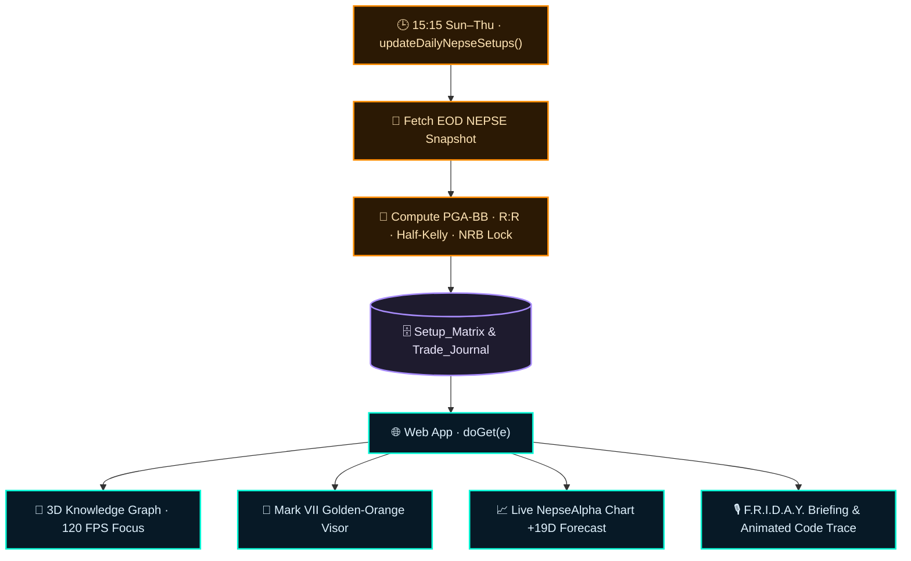

<div align="center">

# 🛰️ NEPSE SENTINEL · MARK VII HUD

**Autonomous Google Apps Script Market Telemetry, 3D Neural Knowledge Graph & F.R.I.D.A.Y. Voice Visor for the Nepal Stock Exchange (NEPSE)**

[](https://script.google.com/macros/s/AKfycbwylMlqcNO4dc5s6P3Aui_aACl-FA0QuzO3pfQs4QQSFRaks8Sy8HlGVQvl-hhRhuGh/exec)

[](https://script.google.com)
[%20%2B%20HTML5-F7DF1E?style=flat-square&logo=javascript&logoColor=black)](https://developer.mozilla.org)
[](#brain-view--friday-telemetry)
[](#data-model)
[](#schedule)
[](LICENSE)

---

> **Live Web App:** [https://script.google.com/macros/s/AKfycbwylMlqcNO4dc5s6P3Aui_aACl-FA0QuzO3pfQs4QQSFRaks8Sy8HlGVQvl-hhRhuGh/exec](https://script.google.com/macros/s/AKfycbwylMlqcNO4dc5s6P3Aui_aACl-FA0QuzO3pfQs4QQSFRaks8Sy8HlGVQvl-hhRhuGh/exec)  
> Zero Colab notebooks or background servers required—opening the Web App loads live setups, backtests, 3D topology, and voice diagnostics automatically.

</div>

---

## 📑 Contents

- [✨ Core Capabilities](#-core-capabilities)
- [⚙️ How It Works](#️-how-it-works)
- [🧠 Brain View & F.R.I.D.A.Y. Telemetry](#-brain-view--friday-telemetry)
- [🕒 Schedule](#-schedule)
- [🎯 Design Decisions](#-design-decisions)
- [🗄️ Data Model](#️-data-model)
- [🔧 Configuration](#-configuration)
- [🚀 Setup](#-setup)
- [🔄 Sync & Deployment Workflow](#-sync--deployment-workflow)
- [🩺 Diagnostics](#-diagnostics)
- [📂 Repository Layout](#-repository-layout)
- [🔒 Security & Limitations](#-security--limitations)

---

## ✨ Core Capabilities

| Subsystem | Module | Capabilities |
| :--- | :--- | :--- |
| **🌅 EOD Telemetry Pipeline** | `DailyNepseSync.js` | Calendar-aware `15:15 NST` sync (`Asia/Kathmandu`), PGA-BB bands, R:R gates, NRB macro locks, and `7.5%` capped Half-Kelly sizing. |
| **🥽 Mark VII Peripheral Visor** | `HelmetBootHUD.html` | Golden-orange glass framing (`SPLIT`, `OVERLAY`, `LIVE`) with embedded NepseAlpha candles, `▲ BUY` / `▼ SELL` markers, and `+19D` forecast cones. |
| **🧠 3D Knowledge Graph** | `GraphUI.html` + `BrainCameraFocus.html` | GPU-accelerated `120 FPS` force-directed topology linking tickers, sectors, sheets, and Apps Script functions with smooth camera node locking. |
| **🎙️ F.R.I.D.A.Y. Voice & Trace** | `JarvisVoice.js` + `JarvisVoiceHUD.html` | Natural female neural voice delivering company briefings and **Real-Time Diagnosis** with line-by-line animated code execution (`INPUT → PROCESS → OUTPUT`). |

---

## ⚙️ How It Works

Two decoupled cloud layers power the system: an unattended afternoon Apps Script trigger that writes ranked setups to Google Sheets, and an on-demand Web App that renders the 3D Knowledge Graph, visor telemetry, voice engine, and live chart window directly in the browser.



* **Calendar-Aware Sync:** `updateDailyNepseSetups` checks the `Asia/Kathmandu` day-of-week before running and skips Fridays and Saturdays when NEPSE is closed, protecting Friday closing levels from stale overwrites.
* **Multi-Gate Backtest Evaluation:** On load, the visor evaluates candidates across `COMBINED`, `PGA-BB`, and `CASCADE` modes, blends model priors with realized `Trade_Journal` win rates, and plots historical `▲ BUY` / `▼ SELL` signals alongside a `+19D` confidence cone.

---

## 🧠 Brain View & F.R.I.D.A.Y. Telemetry

Clicking **`BRIEFING`** or **`REAL-TIME DIAGNOSIS`** in the bottom-right HUD dock switches between market intelligence and live pipeline inspection:

| Mode | Action | Visual & Audio Behavior |
| :--- | :--- | :--- |
| **`VOICE: ON / OFF`** | Toggle audio | Enables or immediately silences F.R.I.D.A.Y.'s speech queue (`Esc` or closing any panel also halts speech immediately). |
| **`BRIEFING`** | Company Report | Speaks an executive breakdown of scanned NEPSE companies, sector coverage, top `BUY` entry/target/stop-loss levels, and Half-Kelly weight. |
| **`REAL-TIME DIAGNOSIS`** | Brain View Trace | Disengages the helmet visor into **Brain View**, centers the `120 FPS` camera reticle onto each active function node (`doGet` → `updateDailyNepseSetups` → `buildKnowledgeGraph` → `evaluateMultiGateSignals` → `getHelmetBacktestJson` → Output Stock), and animates code execution line by line. |
| **`HELMET ON`** | Restore Visor | Re-engages the Mark VII golden-orange peripheral visor and clears node highlights. |

---

## 🕒 Schedule

| Time (NST) | Days | Entry Point | Output |
| :--- | :--- | :--- | :--- |
| `15:15` | Sun–Thu | `updateDailyNepseSetups()` | Refreshed `Setup_Matrix` with ranked `BUY` / `WATCH` targets |
| On open | Any | `doGet(e)` / `getHelmetBacktestJson()` | Live 3D Knowledge Graph, visor gauges, F.R.I.D.A.Y. telemetry, and embedded chart |

---

## 🎯 Design Decisions

| Decision | Rationale |
| :--- | :--- |
| **Zero-Colab Apps Script Architecture** | Eliminates manual notebook runs; both data ingestion and Web App hosting run inside Google's cloud. |
| **Peripheral Golden-Orange Visor** | Keeps the center 3D Knowledge Graph unobstructed while framing telemetry in warm amber-gold glass (`VIEW: SPLIT`, `OVERLAY`, or `LIVE`). |
| **Dedicated `BrainCameraFocus.html` Engine** | Intercepts `ForceGraph3D` / `ForceGraph` factories asynchronously and drives a GPU `translate3d` reticle with delta-time smoothing for lag-free `120 FPS` tracking. |
| **Embedded Live Chart + `+19D` Forecast** | Clicking any stock node opens live NepseAlpha candles alongside historical backtest markers without leaving the tab. |
| **Half-Kelly Sizing Capped at `7.5%`** | Scales position size by win probability and Risk:Reward while preventing single-ticker concentration. |
| **Weekend Guard & Watchlist Fallback** | Skips Fri/Sat market closures (`Asia/Kathmandu`) and falls back to `Watchlist` or core NEPSE tickers if an external JSON endpoint rate-limits. |

---

## 🗄️ Data Model

The application is stateless apart from the bound Google Spreadsheet:

| Sheet | Role | Key Columns |
| :--- | :--- | :--- |
| **`Setup_Matrix`** | Ranked daily setups | `ticker`, `sector`, `signal`, `ltp`, `entry_zone`, `stop_loss`, `target`, `rr_ratio`, `macro_approved`, `kelly_pct`, `updated_at` |
| **`Trade_Journal`** | Closed trade history | `pnl_pct` / `return_pct`, `status` (blended into the `BT ACCURACY` gauge) |
| **`Watchlist`** | Optional custom filter | `ticker`, `sector`, `ltp` (used to restrict or seed daily scans) |

---

## 🔧 Configuration

Optional settings live in **Apps Script → Project Settings → Script Properties** (never committed to Git):

| Property | Required | Purpose |
| :--- | :--- | :--- |
| `NEPSE_FEED_URL` | Optional | Custom JSON market feed URL checked before public NEPSE endpoints and `Watchlist` fallback |

---

## 🚀 Setup

> **Project Timezone:** `Asia/Kathmandu` · **Runtime:** V8

1. Enable the **Google Apps Script API** at [script.google.com/home/usersettings](https://script.google.com/home/usersettings).
2. Clone the Apps Script project locally and initialize the repository:

```powershell
$ScriptId   = "<scriptId>"
$ProjectDir = "D:\Projects\nepse-sentinel-hud"

New-Item -ItemType Directory -Force -Path $ProjectDir | Out-Null
Set-Location $ProjectDir

npm install -g @google/clasp
clasp login
clasp clone $ScriptId --rootDir src
```

3. In the online Apps Script editor:
   * Run `testRunNow()` once to populate `Setup_Matrix` immediately.
   * Run `installDailyNepseTrigger()` once to schedule `updateDailyNepseSetups` at `15:15` (`Asia/Kathmandu`).
   * Click **Deploy → Manage deployments → Edit → New version → Deploy** to publish the `/exec` Web App URL.

### 💻 Restoring on a New Machine

Requires only Node.js, Git, and your Apps Script ID:

```powershell
git clone [https://github.com/Rajubahardar/nepse-sentinel-hud.git](https://github.com/Rajubahardar/nepse-sentinel-hud.git)
Set-Location nepse-sentinel-hud
npx @google/clasp login
npx @google/clasp push --force
```

---

## 🔄 Sync & Deployment Workflow

### ☁️ Cloud Apps Script → Local `src/` → GitHub

Whenever you edit scripts or HTML partials in the online Apps Script editor (`JarvisVoice.gs`, `JarvisVoiceHUD.html`, `BrainCameraFocus.html`, `GraphUI.html`, etc.), pull the latest cloud changes into `D:\Projects\nepse-sentinel-hud\src` and push them to GitHub:

```powershell
Set-Location "D:\Projects\nepse-sentinel-hud"

# 1. Download latest files from Google Apps Script (JarvisVoice.js, JarvisVoiceHUD.html, BrainCameraFocus.html, GraphUI.html, etc.)
clasp pull

# 2. Verify pulled files and git status
git status

# 3. Stage, commit, and push all new changes to GitHub
git add .
git commit -m "Add F.R.I.D.A.Y. voice briefing, Brain View animated code trace, and 120 FPS node camera focus"
git push
```

> [!TIP]
> Remember to click **Deploy → Manage deployments → Edit → New version → Deploy** in the Apps Script editor whenever you want your public `/exec` URL to reflect changes tested on your `/dev` test deployment.

### 🖥️ Local VS Code → Cloud Apps Script → GitHub

If you edit files locally inside `src/` first, push them to Google Apps Script before committing to GitHub:

```powershell
Set-Location "D:\Projects\nepse-sentinel-hud"
clasp push
git add .
git commit -m "Update NEPSE Sentinel HUD"
git push
```

---

## 🩺 Diagnostics

Run any of these functions from the Apps Script editor toolbar and inspect the **Execution log**:

| Function | Reports |
| :--- | :--- |
| `testRunNow()` | Forces an immediate `Setup_Matrix` refresh (bypasses Fri/Sat market-closed guard) |
| `installDailyNepseTrigger()` | Replaces and verifies the daily `15:15` `Asia/Kathmandu` time-driven trigger |
| `getHelmetBacktestJson()` | Returns `Trade_Journal` closed trade count, win count, accuracy %, and `Setup_Matrix` row count |
| `getJarvisBrainTelemetry()` | Returns F.R.I.D.A.Y.'s company briefing payload and 6-step Brain View code execution trace |

---

## 📂 Repository Layout

```text
nepse-sentinel-hud/
├── src/
│   ├── Code.js                  # Spreadsheet orchestration, Web App entry points & backend loaders
│   ├── DailyNepseSync.js        # 15:15 NST market fetcher, PGA-BB / R:R / Half-Kelly evaluator
│   ├── Graph.js                 # Knowledge Graph node/edge builder & sector serialization
│   ├── GraphUI.html             # Primary 3D Knowledge Graph canvas & node inspection UI
│   ├── HelmetBoot.js            # Server-side include() helper & backtest telemetry endpoint
│   ├── HelmetBootHUD.html       # Mark VII golden-orange visor, live NepseAlpha iframe & +19D chart
│   ├── JarvisVoice.js           # F.R.I.D.A.Y. telemetry builder, HTML loaders & 6-stage code trace
│   ├── JarvisVoiceHUD.html      # Female neural voice engine, holographic reticle & animated code card
│   ├── BrainCameraFocus.html    # 120 FPS GPU camera focus & ForceGraph node highlighter
│   └── appsscript.json          # Apps Script manifest, OAuth scopes & Asia/Kathmandu timezone
├── LICENSE                      # MIT License
└── README.md                    # Project documentation
```

---

## 🔒 Security & Limitations

### Security
* `.clasprc.json` (Google OAuth tokens) and `.clasp.json` (project Script ID) are excluded via `.gitignore` and never committed to GitHub.
* The repository is kept private to protect proprietary signal thresholds, watchlists, and trade journal metrics.
* Store any private market feed endpoints in **Script Properties**, never hardcoded in `src/`.

### Limitations
* Public NEPSE JSON endpoints can change schema or rate-limit; when unavailable, `DailyNepseSync.js` falls back to `Watchlist` or core NEPSE tickers until `NEPSE_FEED_URL` is configured.
* The `+19D` future signal forecast curve is a deterministic projection derived from current `LTP`, `Stop Loss`, `Target`, and `PGA-BB` parameters rather than an intraday order-book feed.
* Neural female voices depend on browser Web Speech voices available in the user's OS/browser session (with automatic fallback to local OS female voices inside sandboxed iframes).

---

## 📄 License

This project is licensed under the [MIT License](LICENSE).
