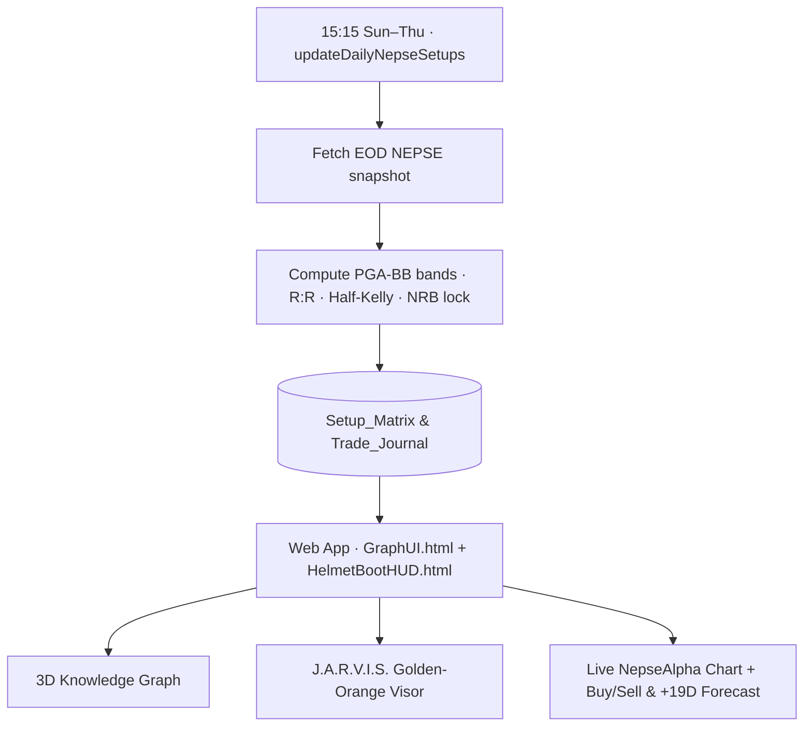

# NEPSE Sentinel

> **Live Knowledge Graph & Visor HUD:** [https://script.google.com/macros/s/AKfycbwylMlqcNO4dc5s6P3Aui_aACl-FA0QuzO3pfQs4QQSFRaks8Sy8HlGVQvl-hhRhuGh/exec](https://script.google.com/macros/s/AKfycbwylMlqcNO4dc5s6P3Aui_aACl-FA0QuzO3pfQs4QQSFRaks8Sy8HlGVQvl-hhRhuGh/exec)

An unattended Google Apps Script market telemetry service and J.A.R.V.I.S.-style Mark VII peripheral helmet visor HUD for the Nepal Stock Exchange (NEPSE). It refreshes daily setups after the 15:00 NST market close, evaluates multi-gate backtest signals, and delivers an interactive 3D Knowledge Graph with live NepseAlpha charts and future signal projections in a single browser view.

Zero Colab notebooks or local background scripts are required. Opening the [Live Knowledge Graph Web App](https://script.google.com/macros/s/AKfycbwylMlqcNO4dc5s6P3Aui_aACl-FA0QuzO3pfQs4QQSFRaks8Sy8HlGVQvl-hhRhuGh/exec) loads everything automatically.

[](https://script.google.com/macros/s/AKfycbwylMlqcNO4dc5s6P3Aui_aACl-FA0QuzO3pfQs4QQSFRaks8Sy8HlGVQvl-hhRhuGh/exec)

%20%2B%20HTML5-F7DF1E?logo=javascript&logoColor=black)


---

## Contents

- [How it works](#how-it-works)
- [Schedule](#schedule)
- [Design decisions](#design-decisions)
- [Data model](#data-model)
- [Configuration](#configuration)
- [Setup](#setup)
- [Future sync workflow](#future-sync-workflow)
- [Diagnostics](#diagnostics)
- [Repository layout](#repository-layout)
- [Security](#security)
- [Limitations](#limitations)

---

## How it works

Two decoupled layers: an unattended afternoon data sync that writes ranked setups to Google Sheets, and an on-demand Web App (`https://script.google.com/macros/s/AKfycbwylMlqcNO4dc5s6P3Aui_aACl-FA0QuzO3pfQs4QQSFRaks8Sy8HlGVQvl-hhRhuGh/exec`) that renders the 3D Knowledge Graph, visor telemetry, and live chart window directly in the browser.



**Daily sync is calendar-aware.** `updateDailyNepseSetups` checks `Asia/Kathmandu` day-of-week before running and automatically skips Friday and Saturday when NEPSE is closed, preventing stale weekend overwrites.

**Multi-gate backtest evaluation.** On load, the visor evaluates candidate tickers across three switchable modes (`COMBINED`, `PGA-BB`, and `CASCADE`), blends model scores with realized `Trade_Journal` win rates, and plots historical `▲ BUY` / `▼ SELL` markers alongside a `+19D` projected confidence cone underneath the live TradingView chart.

## Schedule

| Time (NST) | Days | Entry point | Output |
| --- | --- | --- | --- |
| 15:15 | Sun–Thu | `updateDailyNepseSetups` | Refreshed `Setup_Matrix` with ranked `BUY` / `WATCH` targets |
| On open | Any | `doGet` / `getHelmetBacktestJson` | Live 3D Knowledge Graph, visor gauges, and embedded chart |

## Design decisions

| Decision | Reason |
| --- | --- |
| Zero-Colab Apps Script architecture | Eliminates manual notebook runs; both data sync and UI hosting live inside Google's cloud. |
| J.A.R.V.I.S. golden-orange peripheral visor | Keeps the center 3D Knowledge Graph unobstructed while framing telemetry in warm amber-gold glass (`VIEW: SPLIT`, `OVERLAY`, or `LIVE`). |
| Embedded live NepseAlpha chart + forecast | Clicking any stock locks its graph node and opens live candles alongside historical `▲ BUY` / `▼ SELL` backtests without leaving the tab. |
| Half-Kelly position sizing capped at 7.5% | Scales allocation by win probability and Risk:Reward while preventing single-ticker concentration. |
| Weekend market guard | Skips execution on Fridays and Saturdays (`Asia/Kathmandu`) so non-trading days never corrupt momentum calculations. |
| Watchlist fallback | Falls back cleanly to the `Watchlist` tab or core NEPSE universe if an external JSON feed rate-limits or changes format. |

## Data model

The application is stateless apart from the bound Google Spreadsheet.

| Sheet | Role |
| --- | --- |
| `Setup_Matrix` | Ranked daily setups (`ticker`, `sector`, `signal`, `ltp`, `entry_zone`, `stop_loss`, `target`, `rr_ratio`, `macro_approved`, `kelly_pct`, `updated_at`) |
| `Trade_Journal` | Closed trade history (`pnl_pct` / `return_pct`, `status`) blended into the `BT ACCURACY` gauge |
| `Watchlist` | Optional custom ticker filter (`ticker`, `sector`, `ltp`) used to restrict or seed daily scans |

## Configuration

Optional settings live in **Project Settings → Script Properties**. None are committed to Git.

| Property | Required | Purpose |
| --- | --- | --- |
| `NEPSE_FEED_URL` | optional | Custom JSON market feed URL checked before public NEPSE endpoints and `Watchlist` fallback |

## Setup

Project timezone: `Asia/Kathmandu`. Runtime: V8.

1. Enable **Google Apps Script API** at [script.google.com/home/usersettings](https://script.google.com/home/usersettings).
2. Clone the Apps Script project locally and push to GitHub:

```powershell
$ScriptId   = "<scriptId>"
$ProjectDir = "D:\Projects\nepse-sentinel-hud"

New-Item -ItemType Directory -Force -Path $ProjectDir | Out-Null
Set-Location $ProjectDir

npm install -g @google/clasp
clasp login
clasp clone $ScriptId --rootDir src
```

1. In the Apps Script editor:
   - Run `testRunNow` once to populate `Setup_Matrix` immediately.
   - Run `installDailyNepseTrigger` once to schedule `updateDailyNepseSetups` at `15:15` (`Asia/Kathmandu`).
   - Click **Deploy → Manage deployments → New version → Deploy** to publish the Web App.

**Restoring on a new machine** needs only Node.js, Git, and your Script ID:

```powershell
git clone [https://github.com/Rajubahardar/nepse-sentinel-hud.git](https://github.com/Rajubahardar/nepse-sentinel-hud.git)
Set-Location nepse-sentinel-hud
npx @google/clasp login
npx @google/clasp push --force
```

## Future sync workflow

Whenever you edit scripts or HTML files in the online Apps Script editor, pull the latest cloud changes into `D:\Projects\nepse-sentinel-hud\src` and push them to your private repository:

```powershell
Set-Location "D:\Projects\nepse-sentinel-hud"
clasp pull
git add . ; git commit -m "Update NEPSE Sentinel HUD" ; git push
```

If you edit files locally in VS Code first, push them back to Apps Script before committing to GitHub:

```powershell
Set-Location "D:\Projects\nepse-sentinel-hud"
clasp push
git add . ; git commit -m "Update NEPSE Sentinel HUD" ; git push
```

## Diagnostics

Run any of these from the Apps Script editor toolbar and inspect the execution log.

| Function | Reports |
| --- | --- |
| `testRunNow()` | Forces an immediate `Setup_Matrix` refresh (bypasses Fri/Sat market-closed skip) |
| `installDailyNepseTrigger()` | Replaces and verifies the daily `15:15` `Asia/Kathmandu` time-driven trigger |
| `getHelmetBacktestJson()` | Returns `Trade_Journal` closed trade count, win count, accuracy %, and `Setup_Matrix` row count |

## Repository layout

| File | Responsibility |
| --- | --- |
| `src/Code.js` | Core spreadsheet orchestration, Web App entry points, and backend data loaders |
| `src/DailyNepseSync.js` | Automated 15:15 NST market fetcher, PGA-BB/R:R/Half-Kelly evaluator, and `Setup_Matrix` writer |
| `src/Graph.js` | Knowledge Graph node/edge builder and sector/relationship serialization |
| `src/GraphUI.html` | Primary 3D Knowledge Graph canvas and interactive node inspection UI |
| `src/HelmetBoot.js` | Server-side `include()` helper and `Trade_Journal` / `Setup_Matrix` telemetry endpoint |
| `src/HelmetBootHUD.html` | Mark VII J.A.R.V.I.S. golden-orange visor overlay, live NepseAlpha iframe, and Buy/Sell + `+19D` forecast chart |
| `src/appsscript.json` | Apps Script manifest, OAuth scopes, Web App configuration, and `Asia/Kathmandu` timezone |

## Security

- `.clasprc.json` (Google OAuth credentials) and `.clasp.json` (project Script ID) are excluded via `.gitignore` and never pushed to GitHub.
- The repository is kept private to protect proprietary signal parameters, portfolio watchlists, and personal trade journal metrics.
- Store any private market feed endpoints in **Script Properties**, never hardcoded in `src/`.

## Limitations

- Public NEPSE JSON endpoints can change structure or rate-limit; when unavailable, `DailyNepseSync.js` falls back to the `Watchlist` sheet or built-in sample tickers until `NEPSE_FEED_URL` is configured.
- The `+19D` future signal forecast curve is a deterministic projection derived from current `LTP`, `Stop Loss`, `Target`, and `PGA-BB` parameters rather than an intraday order-book feed.
- Embedded live charts rely on NepseAlpha iframe availability in the user's browser session.
